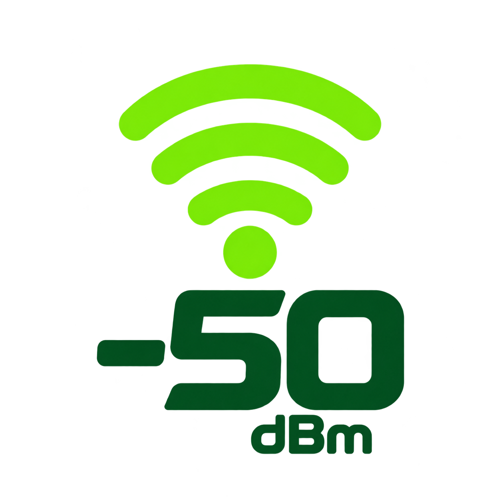
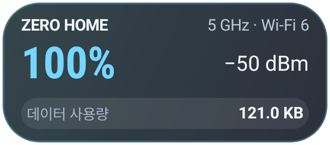
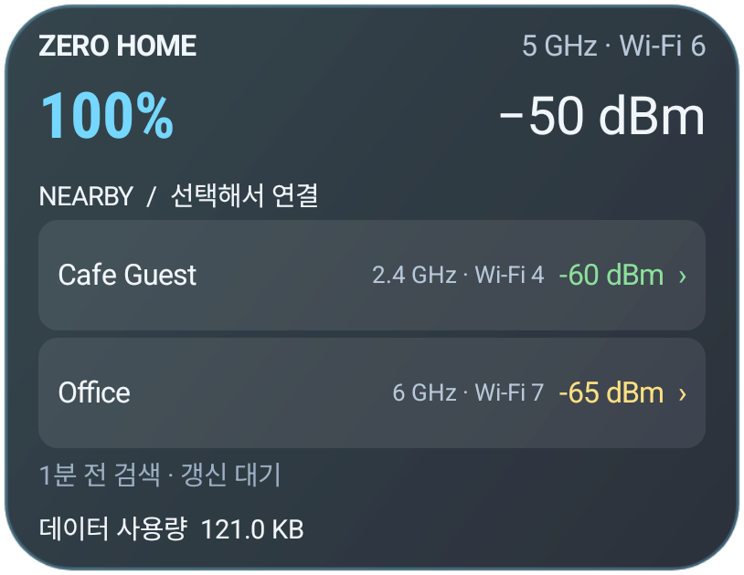

# 디스커넥트제로 · Disconnect Zero

**Wi-Fi 신호 강도와 모바일 데이터 사용량을 홈 화면에서 한눈에.**

### [⬇ 눌러서 앱 설치 파일 받기 (.apk)](https://github.com/ZERO-hms/disconnect-zero/releases/download/v1.0.3/disconnect-zero-1.0.3.apk)

**GitHub 로그인 없이 다운로드할 수 있습니다.** Android 12 이상 · 현재 버전 **1.0.3**

[이번 버전 변경 사항](https://github.com/ZERO-hms/disconnect-zero/releases/tag/v1.0.3) · [공식 배포 페이지](https://github.com/ZERO-hms/disconnect-zero/releases)

## v1.0.3에서 달라진 점

- 라임 그린 Wi-Fi 심볼과 `−50 dBm`을 조합한 새 앱 아이콘 및 앱 상단 로고
- 중간·큰 위젯 상단에 연결된 이름과 대역·버전 표시, 큰 위젯 주변 목록의 현재 연결 항목 중복 제거
- 긴 Wi-Fi 이름, 작은 위젯 크기, 확대 글꼴에서 정보 겹침과 숫자 잘림 개선
- 기존 신호 강도·데이터 집계·자동 업데이트 확인과 알림 기능 유지

아이콘의 `−50 dBm`은 앱의 용도를 표현하는 고정 디자인입니다. 실시간 측정값은 앱과 위젯에서 확인하세요. 아이콘 자체에 배경판은 없지만 런처 설정에 따라 외곽 모양이나 배경이 적용될 수 있습니다.

## 이 앱을 만든 이유

Wi-Fi 아이콘의 몇 칸만으로는 연결 상태를 정확히 느끼기 어렵습니다. 집이나 사무실에서 위치를 옮겼을 때 신호 강도가 얼마나 달라지는지, Wi-Fi가 끊긴 뒤 모바일 데이터를 얼마나 썼는지도 바로 확인하기 어렵습니다.

디스커넥트제로는 **현재 Wi-Fi 신호 강도를 숫자로 확인하고, 주변 네트워크와 모바일 데이터 사용량을 함께 살펴보기 위해** 만들었습니다. 홈 화면 위젯만 봐도 연결 상태를 파악하고 더 나은 위치나 네트워크를 선택하는 데 참고할 수 있습니다.

연결 상태를 알려 주는 모니터링 앱입니다. Wi-Fi 끊김 방지나 인터넷 속도 향상을 보장하지 않습니다.

## 세부 주요 기능

### 1. 신호 강도를 두 가지 숫자로

- **상대 신호 강도(%)**: 높을수록 강한 신호입니다. −90 dBm을 0%, −50 dBm 이상을 100%로 환산한 참고값입니다.
- **실제 수신 신호 강도(dBm)**: 음수로 표시되며 0에 가까울수록 강합니다. 예를 들어 −50 dBm은 −75 dBm보다 강합니다.
- 매우약함 / 약함 / 중간 / 강함 / 매우강함의 **5단계**로 구분하며 배경색도 바뀝니다. 인터넷 속도나 연결 성공률을 뜻하지는 않습니다.

### 2. 1×1 · 2×1 · 3×2 홈 화면 위젯

- 모든 크기에 상대 신호 강도와 dBm, 모바일 데이터 사용량을 표시합니다.
- 2×1·3×2 상단에는 **현재 연결된 Wi-Fi 이름 · 주파수 대역 · Wi-Fi 버전**을 한 줄로 표시합니다. 긴 이름은 말줄임 처리하고 대역·버전은 별도로 유지합니다.
- 3×2에는 주변 Wi-Fi 목록도 보여 줍니다. 이름 옆에 대역·버전을 표시하며 **현재 연결된 이름과 같은 Wi-Fi는 위젯 후보 목록에서 제외**합니다. 같은 이름으로 묶인 다른 AP/대역도 함께 제외됩니다. 이름을 읽을 수 없는 상태에서는 제외 여부를 판별하지 않습니다.
- **배경 불투명도 0–100%, 글씨 크기 80–140%**를 앱에서 조절하고 상단 미리보기로 확인할 수 있습니다.
- 중간·큰 위젯은 텍스트와 가장자리 사이에 여백을 두었습니다. 크기는 홈 화면에서 길게 눌러 테두리로 조절합니다. 실제 배치는 런처 격자에 따라 달라집니다.
- 일반 영역을 누르면 앱이 열리고, 주변 Wi-Fi 항목을 누르면 해당 네트워크의 연결 팝업이 열립니다.

*이미지는 테스트 환경의 예시입니다. 실제 신호 강도·데이터 사용량·목록은 기기와 환경에 따라 달라집니다.*

### 3. 주변 Wi-Fi 정보와 연결 선택

- −75 dBm 이상인 주변 네트워크를 신호 강도 순서로 표시합니다. 같은 이름은 가장 강하게 검색된 항목 하나로 묶습니다.
- 목록에 신호 강도, **2.4 / 5 / 6 GHz 등 주파수 대역**, **Wi-Fi 5 / 6 / 6E / 7 등 규격**을 표시합니다. 기기가 알려 주지 않는 규격은 추측하지 않고 ‘미확인’으로 표시합니다.
- WPA2/WPA3 개인용 네트워크는 **선택한 Wi-Fi 이름이 보이는 팝업**에서 암호를 입력한 뒤 시스템에 저장을 요청합니다.
- 이미 저장한 Wi-Fi는 팝업의 **시스템에서 연결** 버튼으로 기본 Wi-Fi 설정을 열어 선택할 수 있습니다.
- 암호가 없는 네트워크도 시스템 승인이 필요할 수 있습니다. 최종 연결은 Android가 결정하며, 앱이 저장된 네트워크로 강제 전환하지는 않습니다.

### 4. 오늘 / 이번 달 모바일 데이터 사용량

- 기기 전체 모바일 데이터의 **다운로드 + 업로드**를 합산합니다. 여러 SIM 사용량을 포함하고 Wi-Fi 트래픽은 제외합니다.
- Wi-Fi가 끊겨서 사용한 데이터와 의도적으로 사용한 데이터를 모두 포함합니다. 사용 원인별로 구분하지 않습니다.
- 앱에서 **오늘 / 이번 달**을 선택하면 위젯도 같은 기간을 표시합니다.
- 오늘은 현지 시간 자정부터, 이번 달은 1일 자정부터입니다. Android 집계 지연으로 통신사 청구량과 다를 수 있습니다.

### 5. 자동 갱신과 업데이트 알림

- 앱 화면에서는 현재 신호 강도를 약 2초마다, 주변 목록을 약 1분마다 갱신합니다. 백그라운드 갱신은 약 30분 주기입니다.
- **약 6시간마다 새 정식 버전을 자동 확인**하고, 알림을 허용하면 새 버전당 한 번 알려 줍니다. 테스트·베타 릴리스는 업데이트 대상에서 제외합니다.
- 앱의 **지금 업데이트 확인** 버튼으로 즉시 확인할 수 있습니다. 자동 확인·알림은 설정에서 끌 수 있으며, 꺼도 수동 확인은 가능합니다.
- **테스트 알림 보내기**로 실제 알림을 확인하고, 알림 허용 여부·자동 확인 예약 상태·최근 백그라운드 확인 결과를 볼 수 있습니다. 알림을 누르면 앱 업데이트 영역으로 이동합니다.
- 현재 버전 변경사항과 새 버전 변경사항을 앱에서 확인할 수 있습니다. 재부팅·앱 업데이트 후에도 자동 확인 예약을 복구합니다.
- 새 버전은 공식 GitHub APK를 다운로드한 뒤 Android 설치 화면에서 확인합니다. 무인 설치 기능은 아닙니다.
- 절전·네트워크·Android 제한으로 갱신이 지연될 수 있습니다. 앱을 강제 종료했다면 다시 열어 주세요.

## 설치 방법

1. 위의 **APK 다운로드** 버튼을 눌러 `disconnect-zero-1.0.3.apk`를 받습니다.
2. 다운로드한 APK를 열어 설치합니다. 처음 설치할 때 Android가 해당 브라우저나 파일 앱의 ‘이 출처 허용’을 요청할 수 있습니다.
3. 앱을 한 번 열고 필요한 기능의 권한을 선택합니다.
4. 홈 화면의 빈 곳을 길게 누른 뒤 **위젯 → 디스커넥트제로**를 추가하거나 앱의 **홈 화면에 위젯 추가**를 사용합니다.
5. 새 버전 알림을 받으려면 **앱 업데이트 → 업데이트 알림 허용 / 설정**에서 알림을 켭니다.

기존 배포본과 동일한 서명이므로 **기존 앱을 지우지 않고 위에 설치**하면 설정이 유지됩니다.

## 필요한 권한과 개인정보

| 기능 | 필요한 설정 | 사용 목적 |
|---|---|---|
| 현재 신호 강도 | 별도 위치 권한 없이 사용 | 연결된 Wi-Fi 수신 강도 확인 |
| 연결된 Wi-Fi 이름·주변 검색 | 정확한 위치 권한 + 위치 켜기 | Android가 요구하는 네트워크 이름·검색 정보 접근 조건 |
| 앱을 닫은 상태의 이름 갱신·주변 검색 | 위치 항상 허용 | 예약된 이름 갱신과 주변 검색 |
| 모바일 데이터 집계 | 사용정보 접근 허용 | 기기 전체 모바일 데이터 합계 확인 |
| 업데이트 알림 | 알림 허용(선택) | 새로운 앱 버전 안내 |

Wi-Fi 목록과 측정값, 데이터 사용량은 기기에만 저장합니다. 암호는 앱에 저장하거나 로그로 남기지 않습니다. GPS 좌표·앱별 활동 기록·SIM 식별번호는 수집하지 않고 접근성 기능도 사용하지 않습니다.

업데이트 확인은 GitHub에 공개 릴리스 정보를 요청하므로 IP 주소와 앱 버전 등 일반적인 접속 정보가 전달됩니다. Wi-Fi 목록·암호·사용량은 보내지 않습니다.

사용정보 접근이 ‘제한된 설정’으로 차단되면 **설정 → 애플리케이션 → 디스커넥트제로 → 메뉴 → 제한된 설정 허용** 항목을 확인하세요. 권한을 허용하지 않아도 신호 강도 기능은 사용할 수 있습니다.

## 지원 환경과 배포 안내

- Android 12 이상. Galaxy Z Fold7 등 Android 스마트폰에서 사용할 수 있도록 설계했습니다.
- 현재 **정식 v1.0.3**입니다. API 35 에뮬레이터에서 업데이트 설치·버전 조회·알림·위젯 표시를 검증했습니다. 실제 기기별 연결·절전 동작과 장시간 자동 확인은 추가 확인이 필요합니다.
- **이 저장소는 설치 파일과 사용 안내를 배포하는 곳이며, 앱 소스 코드는 공개하지 않습니다.** Releases의 자동 생성 `Source code (zip/tar.gz)`는 이 안내 저장소의 문서 사본으로, 앱 소스나 설치 파일이 아닙니다. 설치하려면 상단 **APK 다운로드**를 이용하세요.
- 현재 변경사항과 검증 범위는 [정식 릴리스](https://github.com/ZERO-hms/disconnect-zero/releases/tag/v1.0.3)와 [검증 안내](VALIDATION.md)에서 확인할 수 있습니다.

문제가 있으면 [Issues](https://github.com/ZERO-hms/disconnect-zero/issues)에 기기 모델, Android/One UI 버전, 앱 버전, 재현 순서를 남겨 주세요. Wi-Fi 암호 등 민감한 정보는 포함하지 마세요.
